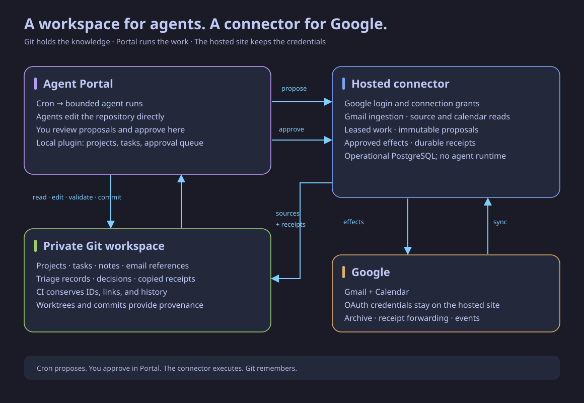

# Architecture

## Three authorities

**Git owns knowledge:** projects, notes, relationships, tasks, source references,
triage records, and copied execution receipts. Portal agents edit this repository
directly in worktrees. CI checks identities, references, and conserved history.
The hosted service never imports the repository or becomes a second project API.

**The connector owns provider operations:** Google refresh tokens, account sync
cursors, cached mail, expiring work claims, immutable action requests, authorization,
and durable execution receipts. These need transactional storage and survive agent
sessions; PostgreSQL is retained for this purpose.

**Portal owns execution and interaction:** scheduled agent runs, conversations,
review, local plugin surfaces, and access to the workspace. Cron means Portal's
scheduler, not a new cron process in this service or a GitHub scheduled workflow.

## Runtime

`crates/backend/src/main.rs` builds an Axum router and starts two independent
Tokio tasks: Gmail ingestion and the connector effect worker. Neither depends on
an AI provider. The old hosted Claude runner and calendar polling stub are removed.

`crates/backend/src/connector/` separates connection authentication, source/work
operations, effects, SQL row models, and contract tests. New typed wire contracts
live in `crates/shared-types/src/connector.rs`. OAuth remains in `auth/`;
Gmail and Calendar clients remain server-side.

The Yew frontend compiles only `app`, `login`, and `connector`. It shows connected
Google accounts and delegated connections. It authorizes/revokes connections;
it does not review provider actions or edit projects. OAuth is a top-level browser
flow. The Portal plugin embeds its own local workspace/review surface, rather than
embedding Google's login flow or relying on third-party cookies.

## Authorization

Login uses the existing Google OAuth state cookie, email allowlist, and HttpOnly
JWT session. This remains a shared personal workspace, not a multi-tenant system.
An administrator can grant a connection only a selected set of connected accounts.

A ten-minute device pairing exchanges a random secret for a 90-day, revocable
bearer credential. Only SHA-256 credential hashes are stored. Agent credentials
can read sources, lease work, export legacy records, and propose actions. Review
credentials can inspect and approve/reject actions in their granted accounts, but
cannot claim work. Website cookies cannot approve provider actions. Browser
connection-management writes require same-origin plus a custom CSRF header.

The effect worker rechecks both proposing and approving grants and the allowlist
before it starts a provider call. Revocation cancels queued work; it cannot undo
an already-started provider call. Agent and reviewer credentials must be kept in
separate execution contexts; different scopes alone do not sandbox processes
running under the same operating-system identity.

## Delivery and recovery

Thirty-minute claims have unique generations, renewable leases, and owner checks.
An expired holder cannot complete or submit work after a replacement claim. Commit
knowledge before submitting effects and completing the claim. Repeating identical
submissions with the same idempotency key returns the original immutable proposal.

Approval moves a proposal into a durable queue. The worker claims it atomically,
executes once, and records provider IDs. Interrupted or uncertain work is marked
`unknown`; the worker never blindly repeats it. Archive retries are safe. Calendar
writes use stable event IDs and check existing calendar entries. A known successful
forward is recorded before archive; a retry can finish that archive without sending
again. An uncertain send cannot be retried through the API.

## Migration bridge

Existing migrations and tables are retained. Legacy project mutations return 410;
legacy reads remain available for historical compatibility. `/api/v1/legacy/export`
exports About Me, categories, todos, and paginated decisions without Google tokens
or raw email bodies. Only the connector ingestion/effects tables receive new work.
The retired feature implementations remain in Git history; old backend read helpers
and their tests are retained while migrating. Legacy DB records are not deleted as
part of cutover, providing a recovery copy.

Production merges build the frontend before the backend, publish the `:main` image,
and deploy through Watchtower. Embedded migrations run before binding the HTTP port.
The container has no Node or agent runtime. `/health` checks database connectivity.
